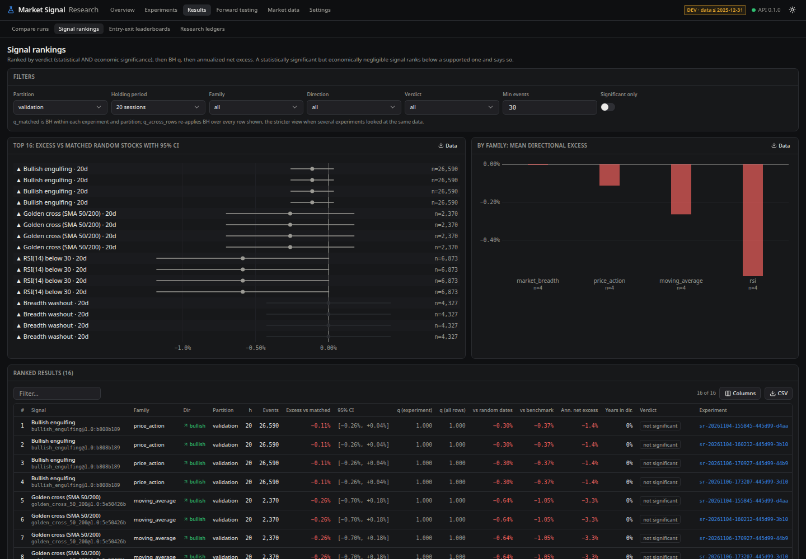

# Market Signal Research

_Formerly "Strategy Lab" (renamed 2026-11-04). The display name changed; the Python package `strategy_lab`, this folder
(`strategy_lab`), the `sl-` book ids and the `ledger_strategy_lab` key keep their names, because the prepared
ptrade bundle, its operator steps and the write-once imported strategy modules reference them._

Historical backtesting and forward paper testing on one engine. Built in the ptrade web terminal's design (React,
Tailwind, shadcn/ui, lightweight-charts) over a FastAPI backend. Dev-only project in Lab: there is no
broker, no live order and no access to HOLDOUT data. Forward execution lives in ptrade, a separate private
paper-trading system that is not part of this repository; Market Signal Research exports strategy bundles
to it and reads results back (see `docs/PTRADE_INTEGRATION.md`).



*Signal Research Lab results: the top 16 entry signals ranked by excess return against matched random entries.*

- Architecture and the audit behind it: `docs/ARCHITECTURE.md`
- Forward integration with ptrade: `docs/PTRADE_INTEGRATION.md`
- Writing strategies: `docs/STRATEGY_API.md`
- Metric definitions: `docs/METRICS.md`
- Signal Research Lab (event studies against matched-random controls): `docs/SIGNAL_RESEARCH.md`
- Entry-Exit Research Lab (entry signals x exit plans, random-entry controls, portfolio backtests):
  `docs/ENTRY_EXIT_RESEARCH.md`

## Run
Requires Python 3.12 or newer, plus Node.js for the web UI.

```
python -m venv .venv
.venv\Scripts\activate        # Windows; on macOS/Linux: source .venv/bin/activate
pip install -e ".[test]"
cd web && npm install && npm run build && cd ..
```

Market data is not included in this repository. The dataset paths in `config/settings.toml` point at a
data folder beside the repo; the test suite and the synthetic data providers run without it.

```
bash scripts/run_tests.sh                       # 239 Python tests (synthetic fixtures; 3 read the workspace data read-only)
cd web && npx vitest run && npx tsc -b && npx vite build   # UI tests, typecheck, build into web/dist
bash scripts/sl.sh serve --port 8070            # API + UI at http://127.0.0.1:8070
bash scripts/sl.sh ingest us_core               # cache a dataset (versioned Parquet snapshot)
bash scripts/sl.sh backtest config.json         # an ExperimentConfig file -> a run
bash scripts/sl.sh reproduce RUN_ID             # re-run and compare artifact hashes
bash scripts/sl.sh forward-advance --to 2025-06-30   # advance the SIMULATED paper host
bash scripts/sl.sh check-contract               # ptrade contract drift (read-only)
<python> scripts/ee_reference_experiment.py main  # the reference entry-exit experiment (us_core, ~1.5 h)
```
Without bash: `<python> scripts/serve.py serve --port 8070`.

### Container (the running instance since 2026-11-16)
```
docker compose up -d                            # API + UI at http://127.0.0.1:8070 (container market-signal-research; no auth, localhost only)
docker compose restart                          # pick up host changes to src/, config/ or web/dist
docker compose exec app python -m strategy_lab ingest us_core    # any CLI command, against the container's state
docker compose build                            # only after changing docker/Dockerfile
```
The image (`docker/Dockerfile`, Python 3.14 on Linux) holds no project code: this folder and the sibling
`data` folder are mounted read-only. `var/` is the named volume `market-signal-research-var`, owned by the
container's non-root user (uid 1000). Tests against the image, with no state volume:
`docker run --rm -v <this folder>:/workspace/strategy_lab:ro -v <../data>:/workspace/data:ro
market-signal-research:0.1.0 python -m pytest tests -q`.

## Layout
```
config/settings.toml      data policy, datasets, universes, storage, forward host
src/strategy_lab/         core (types, strategy API, market view) · engine (broker, portfolio, runner)
                          data (policy, providers, store) · analytics · experiments · strategies · paper · api
                          catalog.py: what the three experiment stores share (catalog.db, recovery, saved configs)
strategies_user/          custom strategies, discovered at startup
src/strategy_lab/signals/  signal catalog (217 signals, 33 families), causal indicator cache, combinations
src/strategy_lab/research/ event-study engine, matched-random / random-date / benchmark controls, statistics, store
src/strategy_lab/entryexit/ exit library (57 components), exit plans, trade replay, pairing engine, store, imports
web/                      the UI (6 sections: Overview; Experiments: all experiments, new backtest / signal study /
                          entry-exit study, library of strategies, signals and exits; Results: compare runs, signal
                          rankings, entry-exit leaderboards, research ledgers, and every result page; Forward
                          testing; Market data; Settings). Old page paths still open their new place.
var/                      generated, gitignored: cache/ (datasets), experiments/ (read-only run dirs), catalog.db,
                          forward/ (deployments, mock host, export bundles), signal_research/ (read-only experiment
                          dirs), signal_imports/ (generated strategy modules of imported signals), entry_exit/
                          (read-only entry-exit experiment dirs), entry_exit_imports/ (imported entry-exit systems)
```

## Guarantees and their tests
| Guarantee | Test |
|---|---|
| no look-ahead (poisoned future bars never change past decisions, for every built-in strategy) | `tests/test_lookahead.py` |
| orders fill only at the next session; full order lifecycle, partial fills, cash/short rules | `tests/test_engine.py` |
| equity = cash + Σ qty·mark every day; cash and positions reconcile to fills | `test_accounting_invariants_hold_every_day` |
| commissions, slippage, spread exact | `test_costs_*`, `test_hl_range_spread_uses_the_previous_bar` |
| splits and dividends (raw mode) | `test_split_*`, `test_dividend_*`, `test_derive_dividends_*` |
| HOLDOUT ceiling, missing data never filled, exchange-holiday calendar | `tests/test_data.py` |
| reproducible runs, immutable artifacts, legacy snapshots | `tests/test_experiments.py` |
| forward == backtest on deterministic data; failure isolation; restatements; idempotent deploy/sync | `tests/test_paper.py` |
| API contract and the end-to-end workflows | `tests/test_api.py` |
| signals: no look-ahead (all 217), indicators vs reference loops, trigger definitions, combinations | `tests/test_signals.py` |
| event study: next-open timing, purged partitions, locked test period, missing data, split-adjusted returns | `tests/test_signal_research.py` |
| controls: same-session same-group pools, leave-one-out means, random dates, benchmarks, reproducible draws | `tests/test_signal_research.py` |
| randomization test calibrated (random signals) and powerful (oracles); BH, bootstrap, verdicts | `tests/test_signal_research.py` |
| append-only test ledger and locked results; failure isolation; cancellation; reproduction by content hash | `tests/test_signal_research.py` |
| imported signal trades exactly the researched events; forward deploy pins the signal code | `tests/test_signal_research.py` |
| one fill model for broker and replay; attached exits (stop-first on the entry bar); precompute causality check | `tests/test_entry_exit.py` |
| every exit component is causal (poisoned future bars change no past series and no closed trade) | `test_no_exit_component_looks_ahead` |
| trade replay == event-driven engine trade by trade (10 plans, missing bars, costs, partials) | `test_replay_matches_the_event_driven_engine` |
| identical events for every exit of an entry; random entries calibrated, oracle detected; BH; walk-forward | `tests/test_entry_exit.py` |
| imported entry-exit system needs a historical backtest before forward deploy; deploy pins the exit code | `test_import_backtest_and_forward_gate` |

## Data policy
- Bars are loaded from 2018-01-01 (warm-up only), backtests start from 2019-01-01, and the hard ceiling is
  2025-12-31 (HOLDOUT starts 2026-01-01). Configuration can lower the ceiling but never raise it.
- Results are labelled with the research periods they overlap (IS 2019-22, OOS 2023-25) and with EXPLORATORY.
- Universes are today's lists, so results carry survivorship bias.

## License

MIT. See `LICENSE`.
